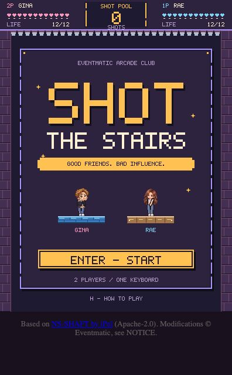
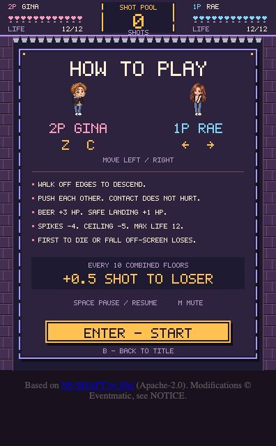
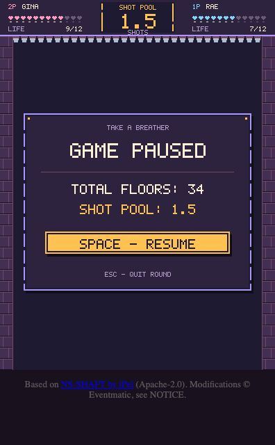
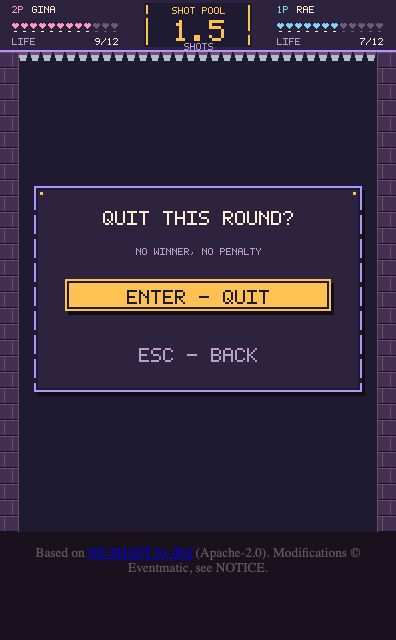
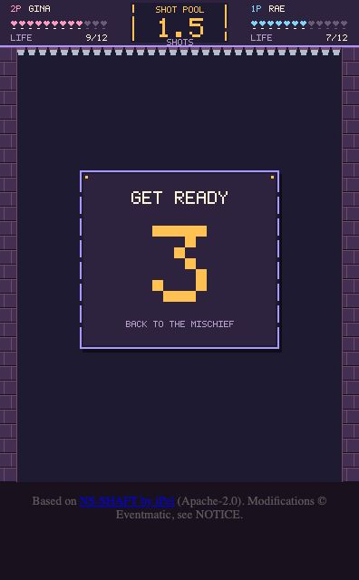
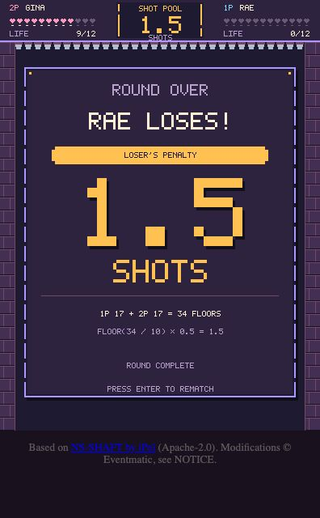
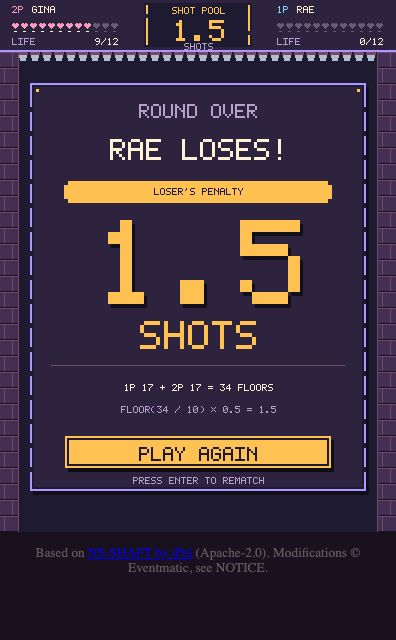
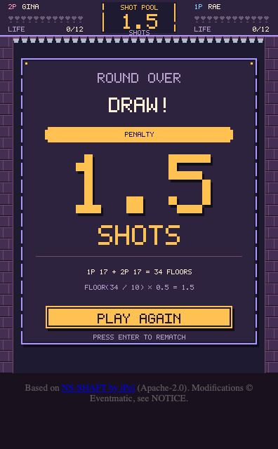

# Phase 2 — actual production screenshots

Approved B screens rendered by the production game. JPEG browser captures, not Phase 0 mockups. Open images at 100% for actual pixel scale. The original attribution remains below the native canvas.

## Native 1× (396 × 532 game canvas)

### Title / Ready

### How to Play

### Pause

### Quit confirmation

### Resume countdown (3)

### Game Over / SHOT result (existing cooldown)

### Rematch action after existing cooldown

### Draw result

## 1080p projector / 2×

792 × 1064 canvas in a 1920 × 1080 viewport, aspect retained.

- [Title / Ready](evidence/phase2/screenshots/title-2x.jpg)
- [How to Play](evidence/phase2/screenshots/howto-2x.jpg)
- [Pause](evidence/phase2/screenshots/pause-2x.jpg)
- [Quit confirmation](evidence/phase2/screenshots/quit-2x.jpg)
- [Resume countdown (3)](evidence/phase2/screenshots/countdown-2x.jpg)
- [Game Over / SHOT result (existing cooldown)](evidence/phase2/screenshots/result-2x.jpg)
- [Rematch action after existing cooldown](evidence/phase2/screenshots/rematch-2x.jpg)
- [Draw result](evidence/phase2/screenshots/draw-2x.jpg)

## Edge cases and projector checks

- [Zero SHOT](evidence/phase2/screenshots/result-zero.jpg)
- [Large SHOT (100000)](evidence/phase2/screenshots/result-large.jpg)
- [Chinese player name](evidence/phase2/screenshots/result-chinese.jpg)
- [Long names and capped result](evidence/phase2/screenshots/result-long-capped.jpg)
- [Instructions with long names](evidence/phase2/screenshots/howto-long.jpg)
- [Countdown 2](evidence/phase2/screenshots/countdown-2.jpg)
- [Countdown 1](evidence/phase2/screenshots/countdown-1.jpg)
- [720p projector / 1× / Chinese name](evidence/phase2/screenshots/projector-720p.jpg)
- [1080p projector / 2× / Chinese name](evidence/phase2/screenshots/projector-chinese-1080p.jpg)
